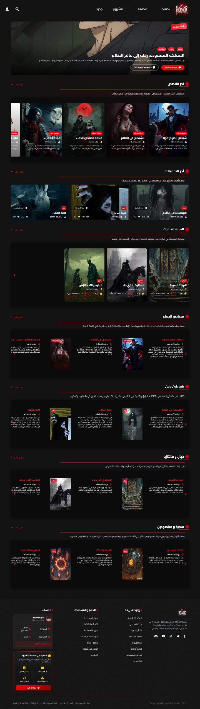
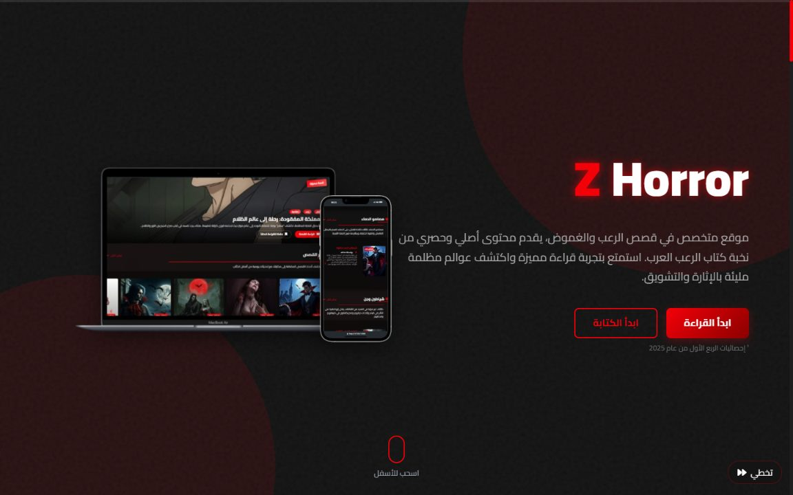
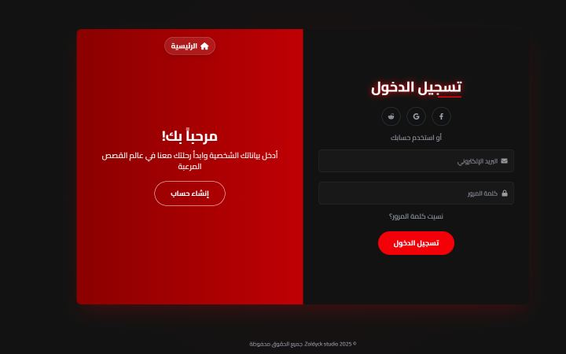
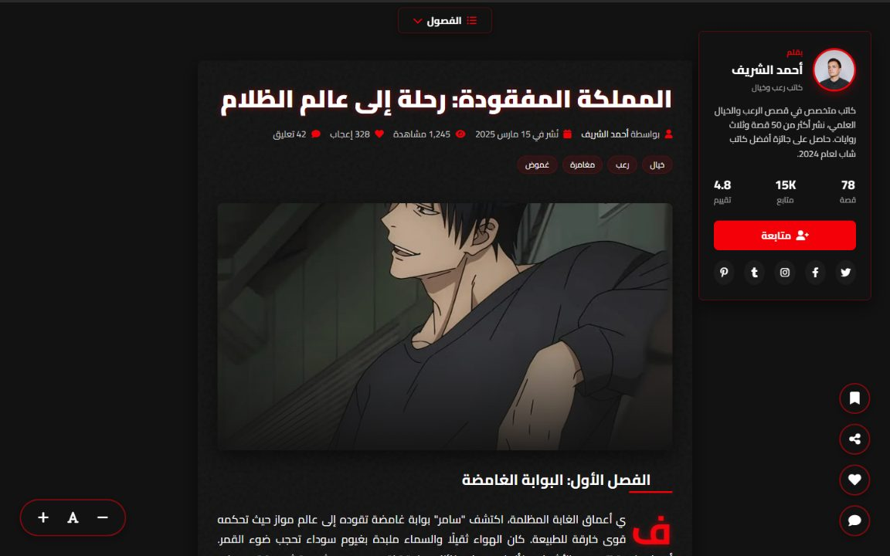

<div align="center">

# Z Horror

**An Arabic-language horror storytelling platform — dark, cinematic front end.**

Static, multi-page, no framework. `lang="ar" dir="rtl"`.

[Pages](#pages) · [Project structure](#project-structure) · [Getting started](#getting-started) · [Licence](#licence)

</div>

---

## Overview

Z Horror is the front end of a horror-story platform where readers discover, read
and publish short horror stories in Arabic. The interface is built around a
dark, high-contrast palette with blood-red accents, animated backgrounds and
layered entrance transitions.

The site is a set of self-contained HTML documents: every page is a complete
screen you can open directly in a browser. Styling and behaviour live in
`assets/css` and `assets/js`, mirroring the page tree one file at a time.

The header and footer are shared, so they are authored once in `components/` and
copied into each page by `scripts/build.mjs`. The result is committed, which is
why the pages still work as plain files.

## Screenshots

Full-page captures, taken with the clock, animations and random seed frozen.

| | | |
|---|---|---|
| **Home** — story feed and categories<br/> | **Welcome** — onboarding for new readers<br/> | **Sign in** — login and registration<br/> |
| **Story reader** — distraction-free reading view<br/> | **Profile** — reader dashboard and published stories<br/> | |

## Tech stack

| | |
|---|---|
| Markup | HTML5, semantic sections, RTL Arabic |
| Styling | [Tailwind CSS](https://tailwindcss.com) via the CDN JIT build, plus a per-page stylesheet |
| Icons | Font Awesome 6 |
| Typography | Cairo ([Google Fonts](https://fonts.google.com/specimen/Cairo)) |
| Behaviour | Vanilla JavaScript (ES2020), no framework, no bundler |
| Hosting | Any static host — plain files, no server code |

## Project structure

```text
zhorror-stories/
├── index.html                     # home page
├── components/                    # shared fragments, embedded by scripts/build.mjs
│   ├── header.html
│   ├── header-authenticated.html
│   ├── footer.html
│   └── footer-extended.html
├── pages/
│   ├── welcome.html
│   ├── auth.html                  # login + registration
│   ├── forgot-password.html
│   ├── reset-password.html
│   ├── story-overview.html
│   ├── story-reader.html
│   ├── profile.html
│   ├── profile-legacy.html
│   ├── creator-profile.html
│   ├── edit-profile.html
│   └── account-settings.html
├── assets/
│   ├── css/                       # one stylesheet per page, same tree as the markup
│   │   ├── index.css
│   │   ├── pages/
│   │   └── components/
│   ├── js/                        # one script per page, plus the shared Tailwind themes
│   │   ├── index.js
│   │   ├── pages/
│   │   ├── components/
│   │   └── config/                # tailwind.config for each theme variant
│   └── images/
├── scripts/
│   └── build.mjs                  # copies the components into the pages
└── docs/
    └── screenshots/
```

Each HTML file carries the document structure only. A page references its own
stylesheet, Tailwind theme config and behaviour script — for example
[pages/auth.html](pages/auth.html):

```html
<script src="https://cdn.tailwindcss.com"></script>
<script src="../assets/js/config/auth.js"></script>
<link rel="stylesheet" href="../assets/css/pages/auth.css">
...
<script src="../assets/js/pages/auth.js"></script>
```

Pages that embed the shared header or footer pull in the matching component
stylesheet and script too. That is the part `scripts/build.mjs` writes:
a component exports its markup between `<!-- @partial:start -->` and
`<!-- @partial:end -->`, and a page names the slot it wants with
`<!-- @include header -->` / `<!-- @include footer -->`. Re-running the script
regenerates those regions in place; the auth screens have neither and keep their
own minimal copyright bar.

The Tailwind theme is not identical everywhere: pages were designed in small
groups, and the design tokens genuinely differ between groups (`fadeIn` is 0.8s
on some pages, 0.3s on others). The eight variants live in `assets/js/config/`
and are shared only by the pages that actually share them.

## Pages

| Page | File | Purpose |
|---|---|---|
| Home | [index.html](index.html) | Story feed, categories, featured stories |
| Welcome | [pages/welcome.html](pages/welcome.html) | Onboarding, statistics, countdown |
| Auth | [pages/auth.html](pages/auth.html) | Login and registration |
| Forgot password | [pages/forgot-password.html](pages/forgot-password.html) | Request a reset link |
| Reset password | [pages/reset-password.html](pages/reset-password.html) | Set a new password |
| Story overview | [pages/story-overview.html](pages/story-overview.html) | Story detail, chapters, rating |
| Story reader | [pages/story-reader.html](pages/story-reader.html) | Reading view, progress |
| Profile | [pages/profile.html](pages/profile.html) | Reader dashboard |
| Profile (legacy) | [pages/profile-legacy.html](pages/profile-legacy.html) | Earlier revision of the dashboard |
| Creator profile | [pages/creator-profile.html](pages/creator-profile.html) | Public author page |
| Edit profile | [pages/edit-profile.html](pages/edit-profile.html) | Profile editor |
| Account settings | [pages/account-settings.html](pages/account-settings.html) | Security and preferences |
| Header | [components/header.html](components/header.html) | Guest header |
| Header (signed in) | [components/header-authenticated.html](components/header-authenticated.html) | Authenticated header |
| Footer | [components/footer.html](components/footer.html) | Site footer |
| Footer (extended) | [components/footer-extended.html](components/footer-extended.html) | Footer with newsletter block |

## Getting started

No dependencies. Either open a page directly:

```bash
start index.html
```

or serve the folder so relative paths and CDN assets behave exactly as in
production:

```bash
npx serve .
# or
python -m http.server 8000
```

Then browse to <http://localhost:8000>.

### Shared components

`node scripts/build.mjs` copies the header and footer out of `components/` into
the pages listed in the script, between their `@include` markers. Run it after
editing a component; run it twice and the second pass changes nothing.

The pages run against no back end: forms, authentication and story data are
front-end only, and the pages are not yet linked to each other — navigate
directly to the file you want to view.

## Contributing

See [CONTRIBUTING.md](CONTRIBUTING.md). Please keep pages self-contained and
leave no inline `<style>` or `<script>` blocks behind.

## Licence

Released under the [MIT Licence](LICENSE).
